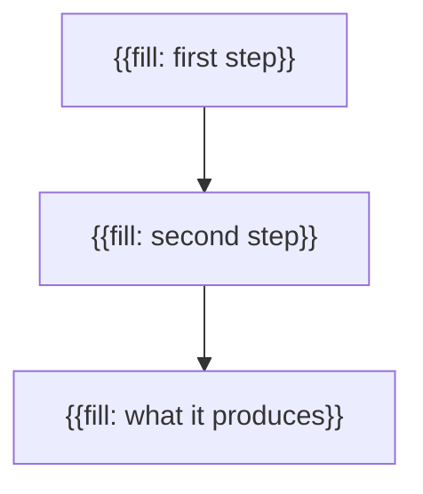

Start a techfabric.com blog post under my byline from the ready-made template, through the techfabric MCP server.

1. **Read the rules.** Read the editorial_rules resource (techfabric://editorial/rules) before you write a word, and follow it over anything here. It is the only copy of the house rules, client confidentiality first. The rules the checks hold a post to most often: the reader is a technology or business leader deciding whether this matters to their organisation (the leadership reader), unless the topic names another; the opening pattern, where sentence one is the reader's problem in their words with a concrete detail and sentence two is who we are and our first-hand angle; a title that is one clause naming the subject; a description of 70 to 160 characters in the same order as the opening; a diagram (a mermaid block); and FAQs at the end.
2. **The template.** It is below, and it is the techfabric://templates/blog-post resource too. Follow its shape and fill every {{fill: ...}} with my own material: lint_draft fails one left in.
3. **The topic.** Take it from what I typed with this command. If I typed nothing, ask me what the post is about, and wait.
4. **Ask for the first-hand part.** Look through this repository and my notes for real work on the topic, read only: change nothing. Then ask me, in one message, for what only I know: what we built or what broke, a number we measured and where it comes from, and what we'd do differently. Wait for my answers, and keep them word for word: send them as sources with submit_draft and update_draft, because the fact-check treats them as my own account of the work, and a first-hand sentence my sources don't back comes back as a finding. Where I have none, write in TechFabric's "we'd" voice and claim no experience. Say plainly what I built, in the past tense, with "we" as the actor ("we built a prototype that ..."), never our product or company in the third person; a prototype is called one once, in that sentence, and the post never disclaims itself (no caveat about the examples, the article or the diagram). Never invent a number, a result, a client or a quote.
5. **Check it.** Call lint_draft on the whole draft. It answers in about a second and costs nothing. Do what its next_action says: rewrite each passage in rewrite_plan as its fix says, keeping every fact I gave you, and call it again, until ready is true. Don't stop early. Then read the draft as the reader in its judge_rubric, answer each question as that reader would, and revise until every answer clears its threshold. Never use check_draft to iterate: it is the final verification, and it costs us. When it passes, or next_action says submit, go straight on to Submit: don't stop after lint, because nothing is on the site until it is filed.
6. **Submit, straight after lint.** File it now with submit_draft (it's private until you publish); the preview opens in the draft app. Call it with the title, the whole post and my words as sources. Its answer starts with the preview link: show it to me.
7. **Verify.** Call check_draft with the id submit_draft returned. It waits while the draft is filed, then runs the final verification (the judge, the slop classifier and the fact-check), which starts on its own once the draft is filed (a couple of minutes) and takes about a minute: call it again while its next_action says wait. If it fails, do what next_action says: rewrite each passage in rewrite_plan, lint_draft with the id and the new text until it passes, save with update_draft, and check_draft again. When next_action says report (after six rounds), stop and show me what's left. Never guess a fact the fact-check asks for: ask me, and send my words as sources. To fix a fact finding, use its correction, cut the sentence back to what its source says, or remove it; never reword it into a new claim, because a rewrite that adds a number, a name or a result comes back as a new finding.
8. **Publish, only with my yes.** When check_draft passes, show me the preview link and what you assumed, then ask me: "Publish '<title>' to techfabric.com now?" and wait. Only on my yes, call publish_draft with the id: it asks me itself, or returns a one-time confirmation you send back only after I say yes. If I say no, or want changes, stop there: it stays a draft (the publish command finishes it later). After publishing, call get_status until its state is published and show me live_url. Never show or ask for the editor link: it is only in my email.

If this is a scheduled or unattended run, or nobody answers you, stop after submit_draft: give the preview link, what you assumed and your questions, and never call publish_draft.

# A techfabric.com blog post: the template

The shape the site's checks hold a blog post to, what goes in each part, and a skeleton to fill in. Read the editorial_rules resource (techfabric://editorial/rules) first: client confidentiality comes before everything here.

## Frontmatter

- title: one clause, in sentence case, that names the subject. No verdict or advice after a colon, and no trailing period.
- metaTitle: only when the title runs past 60 characters: a shorter title for search results that leads with the phrase people search for.
- description: 70 to 160 characters, in the same order as the opening: the reader's problem, then what the post gives them. It is the search snippet and the social card.
- tags: reuse tags the blog already has (list_posts shows them). A tag used once is an archive page with one post on it.
- Leave author, date and draft out: submit_draft sets them to your byline, today in Phoenix and true.

## Opening

- Before the first heading, two to four short paragraphs, in the order of the opening pattern (editorial/voice.md).
- Sentence one is the reader's problem in their own words, named by one concrete detail: a system, a step, a figure. Never their job title, and never our own incident report.
- Sentence two says who we are and our first-hand angle: the engineer in their TechFabric role, or TechFabric's engineers, and the real work behind the post. A post with no story gives our position here instead.
- Then what changes for the reader once the problem is solved, then how, which leads into the first section. Never map the post ('In this post...', 'Below is how...').

## Sections

- Each ## heading names what the section covers, in plain words, with no label and no colon.
- Each section carries more than one sentence: the reasoning, the settings, what we'd do differently.
- First-hand sentences come from what you told your agent, sent as sources. Every number has a source.

## Diagram

- One ```mermaid block, placed beside the prose that names its labels: a plain flowchart TD, eight nodes at most, every label in double quotes.
- Its first line is %% caption: followed by the point the diagram makes, as a sentence of at least eight words with a verb.
- Keep each label short. A fact belongs in the prose, never only in a box.

## Ending

- End the body, before the questions, on a closing paragraph of two sentences or more that says what the reader should do first. Write it as prose, with no one-line kicker and no recap of the post.

## Frequently asked questions

- A ## Frequently asked questions section at the end, with at least 3 ### questions a reader would search for, each heading ending in a question mark.
- Each answer adds something the body doesn't already say, in two to four sentences.

## The skeleton

Replace every {{fill: ...}} with the engineer's own material. lint_draft fails one left in. Never fill one with a guess: ask the engineer.

````markdown
---
title: "{{fill: the subject in one clause, sentence case}}"
description: "{{fill: the reader's problem, then what this post gives them, 70 to 160 characters}}"
tags:
  - "{{fill: a tag the blog already uses}}"
---

{{fill: the reader's problem in their words, named by one concrete detail.}} {{fill: who we are, and the real work behind this post, or our position if there is no story.}}

{{fill: what changes for the reader once the problem is solved, and how, leading into the first section.}}

## {{fill: what the first section covers}}

{{fill: the first part of the argument, in two paragraphs or more, from your own work.}}



## {{fill: what the second section covers}}

{{fill: the settings, the numbers you measured and where each comes from, and what we'd do differently.}}

## {{fill: what the reader does first}}

{{fill: a closing paragraph of two sentences that says what the reader should do first.}}

## Frequently asked questions

### {{fill: a question a reader would search for}}?

{{fill: an answer that adds to the body, in two to four sentences.}}

### {{fill: a second question}}?

{{fill: its answer.}}

### {{fill: a third question}}?

{{fill: its answer.}}

````


What I typed with the command: $ARGUMENTS
